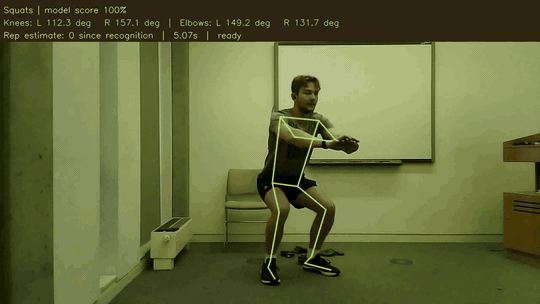

# 🏋️ MotionLab: AI Exercise Recognition and Movement Analysis

**A desktop application that identifies exercises in workout videos and presents joint angles, repetition estimates, and movement summaries.**

<p align="center">
  
  
  
  
  
  
</p>

Open a video and choose **Automatic (AI)**. MotionLab tracks the body, classifies the activity from short movement sequences, and activates the corresponding exercise counter. The results include annotated playback, both knee and elbow angles, an exercise timeline, per-repetition statistics, and CSV exports.

The trained exercise classifier is included. Local analysis runs on CPU and does not require Kaggle, GPU access, training, or an exercise-label CSV.

---

## 🎬 Video demonstration



[Watch the smaller 43-second MP4](assets/readme/demo-43s.mp4) · [View the desktop interface](assets/readme/application.png)


## 🎯 Goal of the work

Build an inspectable workflow for exercise recognition and movement analysis:

- **Recognize activities:** distinguish squats, push-ups, lunges, bicep curls, other exercise, and rest/setup.
- **Measure movement:** display joint angles and summarize the duration and observed range of detected repetitions.
- **Handle tracking gaps:** keep validity and quality information so missing joints do not become false zero-degree angles.
- **Review the evidence:** inspect video overlays, predictions, charts, and exported measurements.

## ✨ Features

| Feature | What the application does |
| --- | --- |
| Automatic exercise recognition | Classifies movement sequences without reading reference exercise labels. |
| Mixed-workout analysis | Follows predicted activity changes within one video. |
| Pose visualization | Draws the tracked skeleton over the source video. |
| Bilateral joint angles | Displays left and right knee and elbow angles. |
| Repetition estimates | Uses separate movement-cycle rules for the four supported exercise types. |
| Per-repetition analysis | Reports duration, observed joint-angle range, and variability within an exercise section. |
| Tracking diagnostics | Records usable-pose coverage, quality fields, and validity flags. |
| Review and export | Saves annotated video, an activity timeline, CSV data, and an HTML summary. |

Other exercise and rest/setup are recognized categories, but they do not activate repetition counters. Manual exercise controls remain available as an optional workflow.

## 🧰 What we used

| Component | Technology | Role |
| --- | --- | --- |
| Source dataset | MM-Fit RGB videos and exercise annotations | Training labels and predefined evaluation partitions. |
| Pose estimation | Pretrained MediaPipe Pose Landmarker Lite | Body landmarks and visibility/presence fields. |
| Feature processing | NumPy and geometric calculations | Relative joint positions, velocities, angles, and validity masks. |
| Exercise classification | PyTorch temporal convolutional networks | Training and comparison of plain TCN and MotionLite. |
| Local inference | ONNX Runtime | Executes the included frozen plain TCN on CPU. |
| Video processing | OpenCV | Decoding, annotated playback, and output video. |
| Desktop interface | PyQt6 and Matplotlib | Video controls, charts, tables, and result review. |

MediaPipe is pretrained. The exercise classifiers were trained separately on extracted pose features. The deployed model is the **plain TCN with 15,894 parameters**; the smaller experimental MotionLite model is retained in the training records.

## 🧩 How it works

1. **Read the video.** Keep source timestamps and sample pose observations at 15 Hz.
2. **Measure the body.** Calculate positions relative to the hip centre, torso-scaled motion, four knee/elbow angles, and tracking-quality flags.
3. **Build a sequence.** Collect 45 observations, approximately three seconds, and select 92 features per observation. The model calculates four additional angle-change features internally.
4. **Predict the exercise.** The TCN outputs six class scores. Predictions update every eight observations; two matching class votes confirm an activity change.
5. **Estimate repetitions.** After confirmation, the relevant movement-cycle rules track supported exercises across successive windows.
6. **Save results.** Export annotated video, predictions, measurements, repetition tables, plots, and an HTML summary.

**Recognition windows and repetitions are different.** Several overlapping windows can describe one slow repetition. A window prediction identifies the activity; a separate counter checks for a completed movement cycle. Warm-up and transitions can omit initial cycles.

## 📚 Dataset and training

The pipeline processed **21 MM-Fit workout videos**. Numerical `.npz` caches stored measurements, timestamps, source-frame numbers, and usable-observation masks. A `windows.csv` index connected each accepted 45-observation sequence to its exercise label and partition.

Windows had to pass timing, label-consistency, exercise-boundary, and tracking checks, including at least **80% usable observations**. The final dataset contained **20,491 retained, overlapping windows**.

| Partition | Workout IDs | Retained windows |
| --- | --- | ---: |
| Training | w01-w04, w06-w08, w16-w18 | 10,176 |
| Validation | w14, w15, w19 | 3,012 |
| Seen-session test | w09, w10, w11 | 3,320 |
| Predefined unseen-subject test | w00, w05, w12, w13, w20 | 3,983 |

Four exercise types have individual labels. Rows, shoulder presses, sit-ups, triceps extensions, lateral raises, and jumping jacks are pooled as `other_exercise`. Background review provisionally accepted 81 of 84 candidate intervals based on three sampled images per interval. Unreviewed annotation gaps were not automatically accepted as rest.

The models use class-weighted cross-entropy, AdamW, batch size 128, dropout 0.15, and seed 42. Training-only normalization and validation macro-F1 determine preprocessing and checkpoint selection. Training ran on a Kaggle Tesla T4. The original full videos and extracted caches are supplied separately and are not included in this repository.

## 📊 Model comparison

| Model | Parameters | Validation macro-F1 | Seen-session test macro-F1 | Unseen-group accuracy | Unseen-group macro-F1 |
| --- | ---: | ---: | ---: | ---: | ---: |
| **Plain TCN: deployed** | **15,894** | 0.9012 | 0.9983 | **94.45%** | **0.9267** |
| MotionLite | 11,656 | **0.9043** | 0.9956 | 89.86% | 0.8426 |

Both saved checkpoints were evaluated frozen, without test-time retraining or normalization fitting. MotionLite uses 26.66% fewer parameters, but the plain TCN performed better overall on the held-out workouts. The app uses the stronger plain model.

These are **classification scores on retained windows**, not full-recording coverage, repetition-count accuracy, or form assessment. Partition names follow the existing protocol; workout IDs are not participant IDs and participant identities were not independently audited. See [saved evaluation results](evidence/results/test/summary.csv) and [per-class metrics](evidence/results/test/per_class.csv).

## 📁 Project structure

```text
MotionLab/
├── run.py                         # Desktop launcher
├── Open App.cmd                   # Windows double-click launcher
├── src/motionlab/                 # Recognition, pose, geometry, counters and GUI
├── assets/
│   ├── exercise_plain_tcn.onnx     # Included trained classifier
│   ├── exercise_plain_tcn.json     # Feature schema, normalization and model hashes
│   └── readme/                     # Small demo GIF, MP4 and interface screenshot
├── scripts/
│   ├── download_pose_model.py      # Downloads and checks the pretrained pose asset
│   ├── run_auto_video.py           # Optional command-line analysis
│   └── export_exercise_model.py    # Optional checkpoint-to-ONNX export
├── ml/                            # Dataset preparation, training and frozen evaluation
├── evidence/
│   ├── checkpoints/               # Saved best checkpoints and training protocols
│   └── results/                   # Selected original metrics, histories and manifests
├── THIRD_PARTY_NOTICES.md          # Dataset and model attribution
└── requirements.txt               # Local app dependencies
```

Local environments, original datasets, extracted caches, full demonstration videos, per-run outputs, personal presentation files, and duplicate archives are excluded from the upload.

## ⚙️ Setup on Windows

**Prerequisite:** Python 3.12. The local application uses CPU inference. Open PowerShell inside the downloaded project folder:

```powershell
py -3.12 -m venv .venv
.\.venv\Scripts\python.exe -m pip install -r requirements.txt
.\.venv\Scripts\python.exe scripts\download_pose_model.py
```

The exercise classifier is already included. The last command downloads the pretrained MediaPipe pose model from Google's model storage and verifies its checksum. It skips downloading when the expected file already exists.

## ▶️ Run the application

```powershell
.\.venv\Scripts\python.exe run.py
```

You can also double-click **Open App.cmd** after setup.

1. Click **Open video** and select a supported video of at least 15 FPS.
2. Keep **Automatic (AI)** selected.
3. Click **Analyze**.
4. Review annotated playback and **Show details**.
5. Use **Save results** to export data or open the output folder.

New analyses are saved under `runs/gui/`. Source and annotated previews are silent. For the supplied short recording, use the README video link; the large saved GUI session remains in the local project rather than the GitHub package.

## 🔬 Current scope and limitations

- **Generalization:** testing used one dataset and one training seed. Performance on new people, environments, and camera views has not been independently established.
- **Coverage:** results exclude rejected windows. The w00 export contains no accepted push-up windows despite push-ups in the original annotations, so rejection and alignment need further review.
- **Background labels:** sampled-frame review is provisional and does not establish dense rest/setup ground truth.
- **Angles and scores:** angles are projected 2D measurements. Tracking quality and class scores are not calibrated uncertainty or assessments of safe exercise form.
- **Counting:** repetition counts are estimates and have not been independently checked against manual counts for the demo excerpts. Recognition warm-up, transitions, and occlusion can miss cycles.
- **Speed:** the existing 79-second video took 108.71 seconds on a Ryzen 5 5500U CPU. The classifier used 0.085 seconds across 113 calls; pose estimation and video handling dominate processing time.

## 🙏 Acknowledgements

MM-Fit by David Strömbäck, Sangxia Huang, and Valentin Radu supplies the source dataset and demo footage. The short previews are edited and annotated derivatives of workout w09. See [MM-Fit](https://mmfit.github.io/), the [video dataset record](https://doi.org/10.5281/zenodo.7672767), and [third-party notices](THIRD_PARTY_NOTICES.md).

The implementation uses [MediaPipe Pose Landmarker](https://ai.google.dev/edge/mediapipe/solutions/vision/pose_landmarker) and established temporal-convolution components. The feature pipeline, model comparison, application integration, and repetition analysis are the work presented in this repository.

